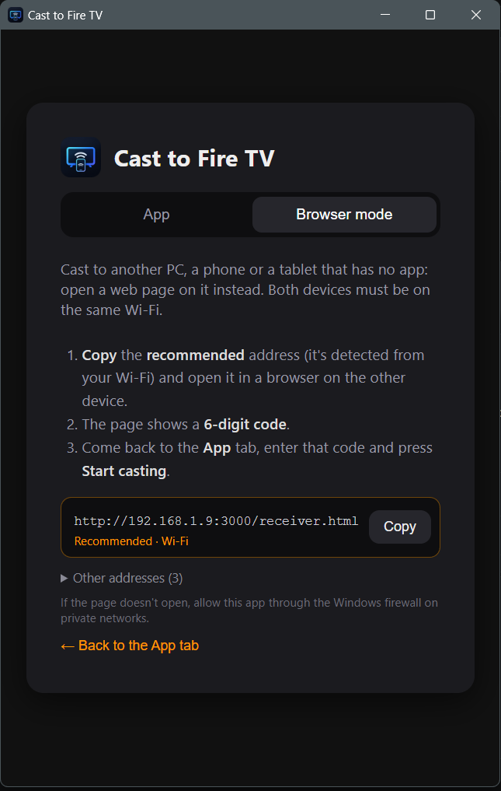

# PC → Fire TV screen mirroring

Mirror your Windows PC's screen and sound to a Fire TV Stick (or any Android TV) over your home Wi-Fi.
WebRTC over your local network. No cloud, no accounts.

## Screenshots
<table>
  <tr>
    <td align="center"><br><sub><b>App</b> – enter the TV code, pick quality, control sound</sub></td>
    <td align="center"><br><sub><b>Browser mode</b> – copy the receiver address for another PC or phone</sub></td>
  </tr>
</table>

## How it works (the 30-second version)
There are two apps:

| App | Runs on | What it does |
|---|---|---|
| **PC app** ("Cast to Fire TV") | Your Windows PC | Captures the screen and sound and sends them |
| **TV app** ("Cast Receiver") | Your Fire TV / Android TV | Shows a 6-digit code and plays what the PC sends |

You enter the TV's code on the PC and press **Start casting**. Both devices must be on the **same Wi-Fi**.

> **Heads-up:** this repository contains only the source code. The finished programs (`.exe` and `.apk` files) are big,
> so they are not stored in Git. You build them yourself with the steps below. It takes a few minutes the first time.

---

## Part 1 – Get the PC app (Windows)

**Install first (one time):** [Node.js](https://nodejs.org) (the LTS version) and [Git](https://git-scm.com).

Open **PowerShell** and run:

```powershell
git clone https://github.com/adi-samson7/Screen-casting-app.git
cd Screen-casting-app
npm install
```

Now pick one way to run it:

| I want to… | Run this | Result |
|---|---|---|
| Just try it quickly | `npm run app` | Opens the app straight from the source |
| Get a portable app | `npm run pack` | `dist\CastApp-win32-x64\CastApp.exe` (keep the **whole folder** together) |
| Get a setup wizard (for installing on other PCs) | `npm run installer` | `installer\Cast-to-Fire-TV-Setup-<version>.exe` |

Notes:
- The first time you start it, **Windows Firewall** asks for permission. Choose **Private networks** and Allow, or the TV can't see your PC.
- The installer is not code-signed, so Windows may show "Windows protected your PC". Click **More info → Run anyway**.
- Close the app before running `npm run pack` again, or Windows says the folder is locked.

---

## Part 2 – Build the TV app (the APK)

An **APK** is the installer file for an Android app (like `.exe` for Windows). You build it once, then install it on the TV.

### 2.1 What you need (one time)
1. Install **[Android Studio](https://developer.android.com/studio)**. It includes everything required: Java, the Android SDK and `adb`.
2. Open Android Studio once and finish its setup wizard so it downloads the SDK.

### 2.2 Build it
Open **PowerShell** in the project folder and run these lines one by one:

```powershell
cd firetv-app
$env:JAVA_HOME = "C:\Program Files\Android\Android Studio\jbr"
.\gradlew.bat assembleRelease
```

- The first build downloads tools and can take **5–10 minutes**. Later builds are much faster.
- When it ends with `BUILD SUCCESSFUL`, your APK is here:
  `firetv-app\app\build\outputs\apk\release\app-release.apk`
- If it complains about a **missing SDK platform** or `sdk.dir`, open the `firetv-app` folder in Android Studio once
  (File → Open). It creates the settings file and offers to install what's missing. Then run the build again.

*Prefer clicking?* Open the `firetv-app` folder in Android Studio and choose **Build → Build APK(s)**.

### 2.3 (Optional) Keep a tidy copy
```powershell
cd ..
mkdir release
copy firetv-app\app\build\outputs\apk\release\app-release.apk release\CastReceiver.apk
```
(The `release` folder is ignored by Git, so it stays on your PC only.)

---

## Part 3 – Install the APK on the TV ("sideloading")

Sideloading means installing an app that isn't from the Amazon store. You do it from the PC over Wi-Fi with a tool called **adb**.

### Step 1 – Set up the TV (one time)
1. On the TV go to **Settings → My Fire TV → Developer options**.
2. Turn **ADB debugging** **ON**.
3. Turn **Install unknown apps** (also called *Apps from Unknown Sources*) **ON** if you see it.
4. Can't see *Developer options*? Go to **Settings → My Fire TV → About**, highlight the device name and press **Select 7 times**. Then go back.

### Step 2 – Find the TV's address
Go to **Settings → My Fire TV → About → Network** and write down the **IP address**, for example `192.168.29.9`.
(It can change when the TV restarts, so check again if a later connection fails.)

### Step 3 – Connect from the PC
Make sure the PC and TV are on the **same Wi-Fi**. In **PowerShell**:

```powershell
cd $env:LOCALAPPDATA\Android\Sdk\platform-tools
.\adb.exe connect 192.168.29.9:5555
```

Replace `192.168.29.9` with **your TV's IP**. The TV shows **"Allow USB debugging?"**: choose **Always allow** and press **OK**.

Check that it worked:

```powershell
.\adb.exe devices
```

Your TV should be listed with the word `device` next to it.

> **No Android Studio?** Download Google's free "SDK Platform-Tools" zip, unzip it, and run the same commands from that folder.

### Step 4 – Install the app
Use the path to your APK. For example, if you followed 2.3:

```powershell
.\adb.exe install -r "C:\path\to\Screen-casting-app\release\CastReceiver.apk"
```

When it prints **`Success`**, it's installed. (`-r` means "replace if already installed", so the same command also updates the app.)

### Step 5 – Open it on the TV
Press **Home**, go to **Apps & Channels**, scroll to the bottom, and open **Cast Receiver**. The first time, you'll see two short welcome screens.

### Troubleshooting

| What you see | What to do |
|---|---|
| `adb is not recognized` | You're not in the `platform-tools` folder. Run the `cd` line again and keep the `.\` before `adb.exe`. |
| `unable to connect` / timeout | Check ADB debugging is ON, both devices are on the same Wi-Fi, and the IP is correct. |
| `unauthorized` in `adb devices` | Look at the TV and accept the "Allow USB debugging?" popup. |
| `INSTALL_FAILED…` | Run `.\adb.exe uninstall com.example.cast` and install again. |
| The app tile shows an orange "amazon fire" picture | Restart the TV (Settings → My Fire TV → Restart) so the home screen refreshes. |

---

## Part 4 – Cast!
1. Open **Cast Receiver** on the TV. It lists every PC running the PC app, by name. Pick yours. The TV shows a **6-digit code**.
2. Open the PC app ("Cast to Fire TV"), enter the code, choose **Quality**, and click **Start casting**.
   - Smooth is best for a Fire TV Stick on weak Wi-Fi.
   - Leave **Always smooth** ticked (30 fps modes). A still screen otherwise drops the stream to about 1 fps, and the picture is slow to wake up when something moves. It keeps a steady frame rate (about 40 kbps when nothing changes) and uses a bit more CPU/GPU.
3. **Sound:** the panel has volume and mute for the Fire TV (and its Bluetooth speaker) and for the laptop. Turning one on mutes the other.
4. **Stream info:** the tickbox "Show stream info" shows or hides the info line on the PC and on the TV. On the remote, **OK/Select** also toggles it.
5. **Back/Menu** on the remote returns to the start screen.

You can also type a PC's address by hand on the TV ("Connect by address"), or use "Browser mode" there.

### Cast to another PC, phone or tablet (Browser mode)
In the PC app, open the **Browser mode** tab. Copy the **recommended** address (detected from your Wi-Fi) and open it in a browser on the
other device. It shows a 6-digit code. Enter that code on the PC's **App** tab and press **Start casting**. Chrome or Edge work best.

### Browser only (no apps at all)
`npm start`, open http://localhost:3000/ in Chrome, and open the printed receiver URL in the Fire TV's Silk browser.

---

## Notes
- The PC and the TV must be on the same network. Guest Wi-Fi or routers with "client isolation" can block discovery. "Connect by address" still works if they can reach each other.
- DRM video (Netflix etc.) shows black. That's a platform restriction.
- The laptop volume control changes Windows' master volume.
- The TV app works on other Android TVs too (Android 5.1+).
- Only your screen and sound travel over your local network. Nothing is sent to the internet.

## License
MIT – see [LICENSE](LICENSE).
