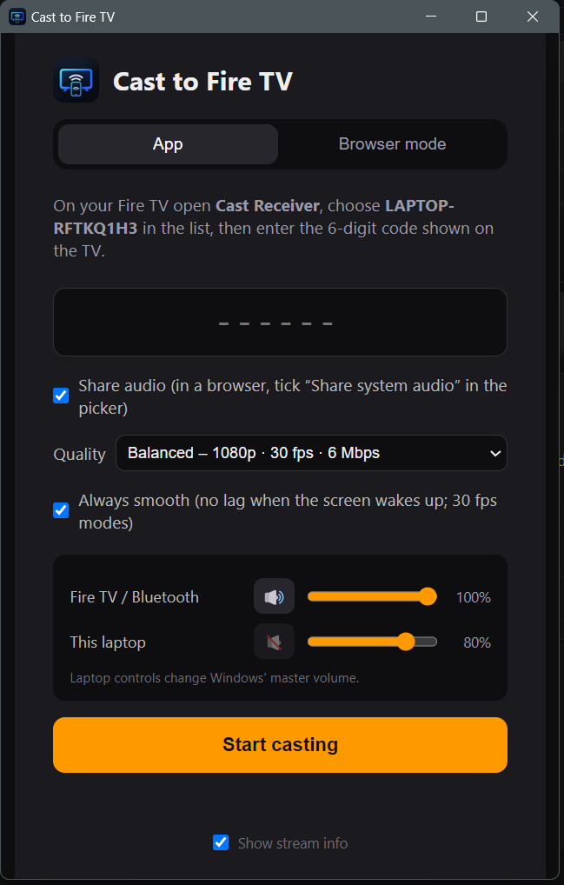

# PC → Fire TV screen mirroring

WebRTC over your local network. No cloud, no accounts.

## Screenshots
<table>
  <tr>
    <td align="center"> <b>App</b> – enter the TV code, pick quality, control sound</td>
    <td align="center"> <b>Browser mode</b> – copy the receiver address for another PC or phone</td>
  </tr>
</table>

## PC app (Electron)
- Run from source: `npm install`, then `npm run app`.
- Build a standalone app: `npm run pack` → `dist/CastApp-win32-x64/CastApp.exe` (copy the whole folder).
- Build a Windows installer (setup wizard): `npm run installer` → `installer/Cast-to-Fire-TV-Setup-<version>.exe` (per-user install, no admin needed; adds Start Menu + Desktop shortcuts and an uninstaller).
- It runs the server and the sender screen together, captures your entire screen + system audio with no picker,
  and shows which encoder is used (GPU/hardware or CPU/software) once you cast.
- Allow it through the Windows firewall (private networks) the first time.

## Fire TV app (native, hardware decoding)
- APK: `release/CastReceiver.apk` (rebuild: `cd firetv-app && gradlew.bat assembleDebug`, needs JDK 17+ and the Android SDK).
- Sideload: Fire TV Settings → My Fire TV → Developer options → turn on ADB debugging and
  "Install unknown apps", note the TV's IP, then
  `adb connect <firetv-ip>` and `adb install -r release/CastReceiver.apk`.
  (Or use the "Downloader" app on the TV.) It appears under Apps & Channels.
- The app lists every PC running Cast to Fire TV by name (UDP broadcast on port 41234). Pick yours, then enter the 6-digit code shown on the TV into the PC app. Nothing connects automatically. You can also type an address by hand.
  Back/Menu on the remote returns to the start screen. "Browser mode" is a fallback using the receiver web page.

## Casting
1. Open the Fire TV app: it shows a 6-digit code.
2. Open the PC app, enter the code, choose Quality (Smooth is best for a Fire TV Stick), click **Start casting**.
   Leave **Always smooth** ticked (30 fps modes): a still screen otherwise drops the stream to ~1 fps and the picture is slow to wake up when something moves. It keeps a steady frame rate (~40 kbps when nothing changes) and uses a bit more CPU/GPU.
3. Sound panel: mute and volume for the Fire TV (and its Bluetooth device) and for the laptop. Unmuting one mutes the other.

## Browser-only (no apps)
`npm start`, open http://localhost:3000/ in Chrome, and open the printed receiver URL in the Fire TV's Silk browser.

## Notes
- PC and Fire TV must be on the same network.
- DRM video (Netflix etc.) shows black. That's a platform restriction.
- Laptop volume controls change Windows' master volume.

## License
MIT – see [LICENSE](LICENSE).
