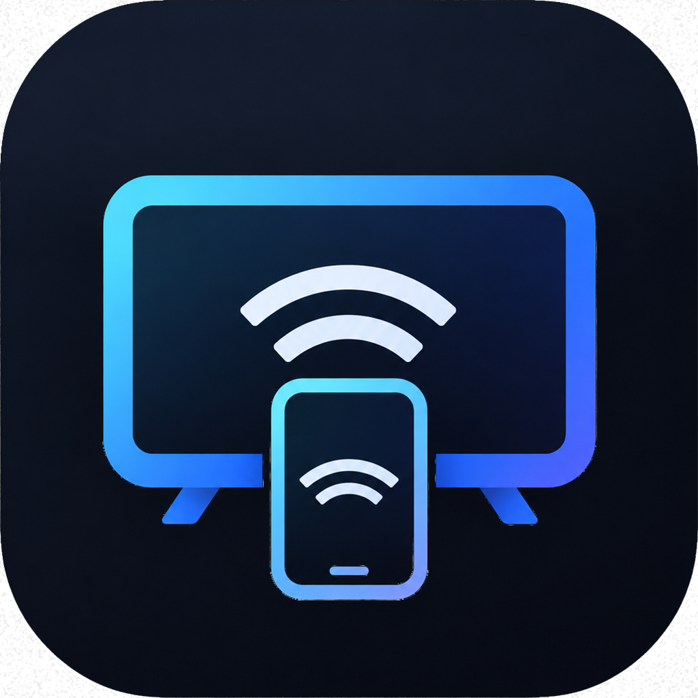
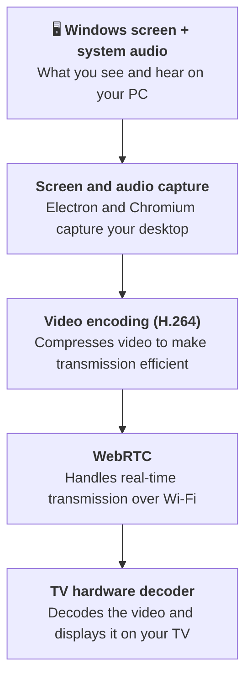

<div align="center">



# Cast to Fire TV

**Mirror your Windows PC's screen and sound to a Fire TV Stick or Android TV, over your own Wi-Fi.**
<br>No cloud. No accounts. No subscription.

[](LICENSE)


<table>
  <tr>
    <td align="center"><br><sub><b>App</b> – enter the TV code, pick quality, control sound</sub></td>
    <td align="center"><br><sub><b>Browser mode</b> – cast to another PC or phone</sub></td>
  </tr>
</table>

</div>

---

## Contents
- [Features](#features)
- [How it works](#how-it-works)
- [Requirements](#requirements)
- [Quick start](#quick-start)
- [Build the PC app](#build-the-pc-app)
- [Build and install the TV app](#build-and-install-the-tv-app)
- [Phone app: cast your phone to a PC](#phone-app-cast-your-phone-to-a-pc)
- [Using the app](#using-the-app)
- [Configuration](#configuration)
- [Project structure](#project-structure)
- [Tech stack](#tech-stack)
- [Troubleshooting](#troubleshooting)
- [Limitations and security](#limitations-and-security)
- [License](#license)

---

## Features

| | |
|---|---|
| 🖥️ **Whole-screen mirroring** | Captures your primary screen and system audio with no picker dialog |
| 🎞️ **Hardware video** | H.264 encoded on the PC's GPU, decoded by the TV's hardware decoder |
| 🎚️ **Quality presets** | Smooth 720p30, Balanced 1080p30, Sharp 1080p30 (10 Mbps), Fast motion 1080p60 |
| ⚡ **Always smooth** | Keeps a steady frame rate even on a still screen, so the picture never "wakes up" slowly |
| 🔊 **Sound control** | Separate volume and mute for the TV (and its Bluetooth speaker) and for the laptop; turning one on mutes the other |
| 🔎 **Automatic discovery** | The TV lists every PC on the network by name. No typing IP addresses |
| 🔢 **6-digit pairing** | You choose the PC and enter the code shown on the TV; nothing connects automatically |
| 🌐 **Browser mode** | Cast to another PC, a phone or a tablet through a web page, with a one-click Copy button and automatic Wi-Fi address detection |
| 📱 **Phone to PC** | An Android app (Cast Sender) casts your phone's screen to a PC, which shows it in a new **Receive** tab |
| 📊 **Live stream info** | Codec, decoder, resolution, fps and packet loss on the PC and the TV, with a show/hide switch |
| ✨ **Glass-style TV UI** | Onboarding on first launch, PC cards, and a pairing screen |
| 📦 **Installer** | A Windows setup wizard with shortcuts and an uninstaller |

---

## How it works

The **PC app** captures and sends to the **TV app**, which receives and plays. A third app, **Cast Sender** for Android phones, sends a phone's screen to the PC.



- A small server inside the PC app only **pairs** the two devices (the 6-digit code) and announces the PC to the TV.
  The video and audio go **directly** from the PC to the TV over your Wi-Fi, never through that server and never over the internet.
- The same stream can be received by the Android TV app or by a web page (Browser mode).

---

## Requirements

| | PC | TV |
|---|---|---|
| **System** | Windows 10 / 11 | Fire TV Stick (any model), Fire TV Cube, or Android TV / Google TV (Android 5.1+) |
| **Network** | Same Wi-Fi / network as the TV | Same Wi-Fi / network as the PC |
| **To build from source** | [Node.js](https://nodejs.org) (LTS) and [Git](https://git-scm.com) | [Android Studio](https://developer.android.com/studio) (includes Java, the Android SDK and `adb`) |

> **Note:** this repository contains only the source code. The finished programs (`.exe` and `.apk`) are large, so they are not stored in Git. Build them with the steps below; the first build takes a few minutes.

---

## Quick start

```powershell
# 1. Get the code and install dependencies
git clone https://github.com/adi-samson7/Screen-casting-app.git
cd Screen-casting-app
npm install

# 2. Start the PC app
npm run app
```

Then [build the TV app](#build-and-install-the-tv-app), install it on the TV, and follow [Using the app](#using-the-app).

---

## Build the PC app

| I want to… | Run | Result |
|---|---|---|
| Try it quickly | `npm run app` | Opens the app straight from the source |
| A portable app | `npm run pack` | `dist\CastApp-win32-x64\CastApp.exe` (keep the **whole folder** together) |
| A setup wizard | `npm run installer` | `installer\Cast-to-Fire-TV-Setup-<version>.exe` |

- The installer is per-user (no admin rights needed) and adds Start Menu and Desktop shortcuts plus an uninstaller.
- The installer is **not code-signed**, so Windows may show "Windows protected your PC". Click **More info → Run anyway**.
- On first start, Windows Firewall asks for permission. Choose **Private networks** and Allow, or the TV cannot see your PC.
- Close the app before running `npm run pack` again, or Windows reports the folder as locked.

---

## Build and install the TV app

An **APK** is the installer file for an Android app (like `.exe` on Windows). You build it once, then install it on the TV with `adb` over Wi-Fi ("sideloading").

### 1. Build the APK
Install **Android Studio** and open it once so it downloads the Android SDK. Then, in PowerShell:

```powershell
cd android
$env:JAVA_HOME = "C:\Program Files\Android\Android Studio\jbr"
.\gradlew.bat :tv:assembleRelease
```

- The first build downloads tools and can take several minutes; later builds are faster.
- When it prints `BUILD SUCCESSFUL`, the file is at `android\tv\build\outputs\apk\release\tv-release.apk`.
- If it reports a missing SDK platform or `sdk.dir`, open the `android` folder in Android Studio once (File → Open). It creates the settings file and offers to install what is missing.
- Prefer clicking? In Android Studio choose **Build → Build APK(s)**.

### 2. Prepare the TV (one time)
1. On the TV: **Settings → My Fire TV → Developer options**.
2. Turn **ADB debugging** ON. Turn **Install unknown apps** ON if you see it.
3. No *Developer options*? Go to **Settings → My Fire TV → About**, highlight the device name and press **Select 7 times**.
4. Find the TV's address: **Settings → My Fire TV → About → Network**. Note the **IP address** (for example `192.168.29.9`). It can change after a restart.

### 3. Connect and install
Make sure the PC and TV are on the same Wi-Fi, then:

```powershell
cd $env:LOCALAPPDATA\Android\Sdk\platform-tools
.\adb.exe connect 192.168.29.9:5555      # use YOUR TV's IP
```

The TV shows **"Allow USB debugging?"**. Choose **Always allow** and press OK. Check the connection:

```powershell
.\adb.exe devices                        # your TV should be listed as "device"
.\adb.exe install -r "C:\path\to\tv-release.apk"
```

`Success` means it is installed (`-r` replaces an existing copy, so the same command also updates the app).
Open it from **Home → Apps & Channels → Cast Receiver**.

> No Android Studio? Download Google's free **SDK Platform-Tools** zip, unzip it, and run the same `adb` commands from that folder.

---

## Phone app: cast your phone to a PC

**Cast Sender** is a separate Android app. It shows your phone's screen on a PC running the Cast app.

**Build it** (same tools as the TV app):
```powershell
cd android
$env:JAVA_HOME = "C:\Program Files\Android\Android Studio\jbr"
.\gradlew.bat :phone:assembleRelease
```
The file is `android\phone\build\outputs\apk\release\phone-release.apk`.

**Install it on the phone:** copy the APK to the phone (USB cable, Google Drive, …), open it, and allow **Install unknown apps** when Android asks. Needs Android 7 or newer.

**Use it:**
1. On the PC, open the Cast app and go to the **Receive** tab. It shows a 6-digit code.
2. On the phone, open **Cast Sender**. It lists the PCs on your Wi-Fi: pick yours.
3. Enter the code, choose a quality, and press **Start casting**. Android asks for permission to share your screen (choose **Share entire screen**).
4. The phone's screen appears in the PC's Receive tab. Double-click it (or press **Full screen**) to enlarge it. Rotating the phone resizes the picture.
5. Stop from the app, from the notification, or from the PC.

Good to know: this first version sends **video only (no sound)**, and a still screen sends very few frames, so the picture can look frozen until something moves. Sound and a steadier frame rate are planned.

---

## Using the app

1. **TV:** open **Cast Receiver**. It lists every PC running the PC app, by name. Pick yours. The TV shows a **6-digit code**.
2. **PC:** open the app, enter the code on the **App** tab, choose a **Quality**, and press **Start casting**.
   - *Smooth* is best for a Fire TV Stick on weak Wi-Fi.
   - Leave **Always smooth** ticked (30 fps modes). A still screen otherwise drops the stream to about 1 fps, and the picture is slow to wake up when something moves.
3. **Sound:** use the sound panel for the TV (and its Bluetooth device) and the laptop. Turning one on mutes the other.
4. **Stream info:** the "Show stream info" tickbox shows or hides the info line on the PC and the TV. On the remote, **OK/Select** toggles it too.
5. **Back/Menu** on the remote returns to the start screen.

You can also type a PC's address on the TV (**Connect by address**).

### Cast to another PC, phone or tablet (Browser mode)
Open the **Browser mode** tab, copy the **recommended** address (detected from your Wi-Fi), and open it in a browser on the other device. It shows a 6-digit code: enter it on the PC's **App** tab and press **Start casting**. Chrome or Edge work best.

### Browser only (no apps at all)
Run `npm start`, open `http://localhost:3000/` in Chrome, and open the printed receiver URL in the TV's Silk browser.

---

## Configuration

| Setting | How | Default |
|---|---|---|
| PC name shown on the TV | Environment variable `CAST_NAME` | Windows computer name |
| Server port (`npm start` only) | Environment variable `PORT` | `3000` (the app tries up to 9 ports above it if busy) |
| Discovery | UDP broadcast on port `41234` | Fixed |

The PC page remembers Quality, Always smooth and Show stream info. The TV app remembers whether onboarding is done, the last typed address, and Show stream info.

---

## Project structure

```
├─ electron/main.js        PC shell: window, GPU flags, screen + audio capture
├─ server.js               Web server, signaling (WebSocket), discovery beacon, address detection
├─ public/
│  ├─ sender.html          PC interface: capture, WebRTC sender, controls
│  └─ receiver.html        Browser receiver (Browser mode)
├─ pc-audio.ps1            Reads / sets Windows volume and mute
├─ android/                Android project (Kotlin), three modules
│  ├─ core/                Shared: glass-style UI (Glass.kt), PC discovery, WebRTC helper
│  ├─ tv/                  Fire TV / Android TV receiver app ("Cast Receiver")
│  │  └─ src/main/java/com/example/cast/
│  │     ├─ MainActivity.kt        Finds PCs, lists them
│  │     ├─ ReceiverActivity.kt    WebRTC receiver + hardware decoder
│  │     ├─ OnboardingActivity.kt  First-launch screens
│  │     └─ WebActivity.kt         Browser-mode fallback
│  └─ phone/               Phone sender app ("Cast Sender")
│     └─ src/main/java/com/example/castsender/
│        ├─ MainActivity.kt        PC list, code entry, casting screen
│        ├─ CastService.kt         Foreground service: capture + WebRTC sender
│        ├─ ProjectionCapturer.kt  Screen capture that survives rotation
│        └─ Quality.kt             Quality presets
├─ assets/                 Logo and Windows icon
└─ docs/screenshots/       Images used in this README
```

---

## Tech stack

| Area | Technology |
|---|---|
| PC shell | Electron 33 |
| Server | Node.js, `ws` (WebSocket) |
| Media | WebRTC: H.264 video, Opus audio (stereo) |
| TV and phone apps | Kotlin, `stream-webrtc-android`, OkHttp, MediaCodec (TV decode / phone encode), MediaProjection (phone screen capture) |
| Windows volume | PowerShell with COM (`IAudioEndpointVolume`) |
| Packaging | `@electron/packager`, `electron-builder` (NSIS), Gradle |

---

## Troubleshooting

<details>
<summary><b>The TV cannot see my PC</b></summary>

- Both devices must be on the same Wi-Fi. Guest networks and routers with "client isolation" can block discovery.
- Allow the app through Windows Firewall on **Private networks**.
- Use **Connect by address** on the TV with the address from the PC's Browser mode tab.
</details>

<details>
<summary><b><code>adb</code> problems</b></summary>

| You see | Do this |
|---|---|
| `adb is not recognized` | Run the `cd` line first and keep the `.\` before `adb.exe` |
| `unable to connect` / timeout | Check ADB debugging is ON, both on the same Wi-Fi, and the TV's IP is current |
| `unauthorized` | Accept the "Allow USB debugging?" popup on the TV |
| `INSTALL_FAILED…` | `.\adb.exe uninstall com.example.cast`, then install again |
</details>

<details>
<summary><b>The app tile on the TV shows an orange "amazon fire" picture</b></summary>

Restart the TV (**Settings → My Fire TV → Restart**) so the home screen refreshes, or reinstall the app.
</details>

<details>
<summary><b>The picture is choppy or low frame rate</b></summary>

Choose **Smooth** quality, move closer to the router (5 GHz works best), and check the stream-info line for lost or dropped frames.
</details>

---

## Limitations and security

- Designed for a **trusted home network**. The 6-digit code is a simple pairing code, not strong authentication, and signaling is not encrypted. Do not use it on public or shared Wi-Fi.
- One PC to one TV at a time. Primary screen only. The phone app sends to a PC only (not to a TV yet) and has no sound yet. Windows only on the PC side (the laptop volume control and system-audio capture use Windows features).
- Works on the local network only (no internet relay).
- DRM-protected video (Netflix and similar) shows black; that is a platform restriction.
- The laptop volume control changes Windows' master volume.
- The installer and APK are not code-signed (the APK uses a debug key, which is fine for sideloading).

---

## License

Released under the [MIT License](LICENSE). © 2026 Aditya Samson
